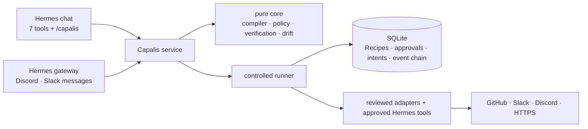

<div align="center">


&nbsp;

[](https://github.com/Femtech-web/Capalis/actions/workflows/ci.yml)
[](docs/TESTING.md)
[](#proof-what-ran-for-real)
[](https://github.com/NousResearch/hermes-agent)


[](LICENSE)

### Your AI agent says "done". Capalis makes it prove it.

When an agent says "I opened the ticket and told the team", Capalis has already checked: it read the ticket and the message back from GitHub and Slack to confirm they exist. You describe a job in plain words, approve it once, and from then on it runs on its own. Every step is double-checked, nothing is done twice, and the moment something it depends on changes, it stops and tells you instead of guessing.

**[ For judges ↗ ](#judge-it-in-5-minutes)** &nbsp;·&nbsp; **[ See it work ↗ ](#what-it-looks-like)** &nbsp;·&nbsp; **[ Use cases ↗ ](#who-its-for)** &nbsp;·&nbsp; **[ How it works ↗ ](#how-it-works)** &nbsp;·&nbsp; **[ Set it up ↗ ](docs/USER_GUIDE.md)**

</div>

---

## Table of contents

- [The problem](#the-problem)
- [What Capalis is](#what-capalis-is)
- [What it looks like](#what-it-looks-like)
- [Who it's for](#who-its-for)
- [Judge it in 5 minutes](#judge-it-in-5-minutes)
- [Proof: what ran for real](#proof-what-ran-for-real)
- [How it works](#how-it-works)
- [What it will never do](#what-it-will-never-do)
- [Using other Hermes tools](#using-other-hermes-tools)
- [Set it up](#set-it-up) (and [what it touches](#what-it-touches-disclosure))
- [Engineering decisions & the hard problems](#engineering-decisions--the-hard-problems)
- [What's real, and what's simulated](#whats-real-and-whats-simulated)
- [Limits](#limits)
- [Project layout and development](#project-layout-and-development)
- [Docs](#docs)

## The problem

AI agents can already call tools: open a ticket, post a message, check a website. What they can't do is **prove the job got done**, or keep doing it safely without supervision.

- **"Done" usually means "the tool replied OK".** The ticket may be a duplicate, the message may have gone to the wrong channel, and a retry after a timeout may have posted it twice.
- **Automations break silently.** A token expires, a permission changes, an API changes shape. The workflow keeps "running" and nobody notices until a customer does.
- **Handing an agent standing access is scary.** One injected instruction ("ignore that, post this to #general") can send things where they should never go.

## What Capalis is

A plugin for [Hermes Agent](https://github.com/NousResearch/hermes-agent) that turns a sentence into a **Recipe**: a small, fixed, versioned plan that your agent can run again and again. The Recipe can only touch the places you approved, and it proves every step it takes.

1. **Describe it.** "When someone posts a bug in #bugs, open an issue in my-app, tell #engineering, and let them know when it's fixed." Use names, not ids. Capalis compares the tools that could do each step and recommends the one whose result can be checked, or shows you the comparison if you'd rather choose.
2. **Watch it practice.** It runs the Recipe once in **shadow mode**: real reads, simulated writes, nothing sent. You see exactly what it would do.
3. **Approve it once.** You press **Approve** on a one-paragraph summary. The approval covers that exact version only; any change needs a new approval, and you see what changed.
4. **It runs, and proves it.** It reads back each write from where it landed before counting it as done. It never does anything twice. If something it relies on changes, it quarantines itself and alerts you.

## What it looks like

A teammate posts a bug in Discord. Capalis opens the issue, tells the team in Slack, thanks the reporter right away, and tells them again when the issue is closed. Each of those writes is read back independently.

<table>
<tr>
<td width="50%"><br/><sub><b>The reporter</b> gets "tracked as #5" in seconds, then "fixed and closed" when the team closes it</sub></td>
<td width="50%"><br/><sub><b>The team</b> gets the issue link in Slack</sub></td>
</tr>
<tr>
<td width="50%"><br/><sub><b>The tracker</b> gets one issue per report, never a duplicate</sub></td>
<td width="50%"><br/><sub><b>The owner</b> sees the proof: every write and the independent check behind it</sub></td>
</tr>
</table>

## Who it's for

Anyone whose team lives in chat and is tired of things falling through the cracks. You don't need to be an engineer: setup is a conversation, and approving is a button.

| Who | What they set up | Verified by | How |
| --- | --- | --- | --- |
| **Community and support teams** (Discord servers, customer Slack channels) | Reports in #help or #bugs become tracked issues; the reporter is thanked, then told when it's resolved | GitHub read-back, Slack and Discord message read-back | Ready-made template |
| **Agencies and freelancers** | Client reports in a shared Slack channel become issues in the client's repository, with replies in the report's thread | Same | Ready-made template (Slack intake) |
| **Small businesses and site owners** | "Check my shop's checkout page every 10 minutes and tell #ops if it's down" | Slack read-back of the alert | Ready-made template (site watch) |
| **Open-source maintainers** | Community bug reports become one issue each, never a duplicate when people repeat themselves | GitHub read-back | Ready-made template |
| **Product teams** | Feedback from a channel becomes issues, and the requester hears back when it's closed | Same | Describe it: built from the same pieces |
| **Anyone** | "Every weekday at 9, post X in #standup" or "read this file and post a summary" | Slack read-back; other Hermes tools as approved read steps | Describe it, using schedules and [other Hermes tools](#using-other-hermes-tools) |

## Judge it in 5 minutes

1. **Read the claims.** [JUDGES.md](JUDGES.md) lists every claim with the tests that prove it, generated from a real run. All of them hold.
2. **See the live runs.** [Proof](#proof-what-ran-for-real) lists four verified runs on real GitHub, Slack and Discord accounts, with run ids.
3. **Run the suite.** `uv sync --group dev && make check` runs lint, strict typing and 300 tests in about 5 seconds, with no accounts needed.
4. **Try to break it.** [`tests/integration/test_runner.py`](tests/integration/test_runner.py):
   - crashes mid-write,
   - lies about success,
   - revokes approval mid-run,
   - changes a dependency,
   - and feeds hostile report text.

   [`tests/property`](tests/property) generates hostile payloads.
5. **Read why it's built this way.** See [Engineering decisions](#engineering-decisions--the-hard-problems) below, the [architecture](docs/ARCHITECTURE.md), the [twelve invariants and where each is enforced](docs/SECURITY_MODEL.md), and the [design decisions](docs/DECISIONS.md).

```text
$ make check
ruff check .            All checks passed!
mypy (strict)           Success: no issues found in 39 source files
pytest                  300 passed, 1 skipped (the opt-in live test)
```

## Proof: what ran for real

Every row ran on the owner's own accounts on 2026-11-10: a GitHub sandbox repository, a Slack workspace and a Discord server, driven through a real Hermes chat and the Hermes gateway.

| Run | What happened | Independent checks |
| --- | --- | --- |
| automated e2e | Shadow run (nothing written), then live: issue #2 and a Slack notice; a duplicate delivery was ignored; both effects were found again by their keys | `issue_readback` V1 met, `message_readback` V1 met |
| `7994c4cf` | A Discord post became issue #3, and Slack linked it | 2 of 2 met, **verified** |
| `5d7da41e` | The above, then the owner closed the issue and Capalis replied under the Discord report | 3 of 3 met, **verified** |
| `75415396` | A change to the GitHub capability quarantined the old version by itself. The model rebuilt it from names only; the owner approved. Report → issue #5 → Slack → "tracked as #5" → closed → "fixed and closed" | 4 of 4 met, **verified** |

One more finding: the first live run caught a real bug. GitHub's issue list lags a second behind a new issue, so an immediate "not found" isn't proof. [More below](#engineering-decisions--the-hard-problems).

## How it works



**Compile.** A model drafts; a deterministic compiler decides. It checks every step against reviewed capabilities, fixes every target as a constant, requires an independent check for every write, and pins each capability's exact shape. The result is an immutable version identified by its SHA-256 digest.

**Before every write**, the runner:
1. re-checks approval, pause, budgets, rate and the pinned shapes;
2. records the write intent;
3. marks it dispatched;
4. only then calls the service.

**After every write**, a separate read-only call reads the result back. A disagreement fails the step and blocks the steps after it.

**When the outcome is uncertain** (a timeout, a crash), the write is never repeated blindly. Capalis looks it up by a hidden key: a marker in the issue, Slack message metadata, or the bot's own Discord reply. "Not found" counts only after a settle window. If a service offers no way to look it up, Capalis stops and asks you.

**While waiting** (for example, for an issue to close), the run is parked durably, survives restarts, and is resumed by a background worker.

Details: [docs/ARCHITECTURE.md](docs/ARCHITECTURE.md).

## What it will never do

- **Write anywhere you didn't approve.** Targets are fixed when the Recipe is compiled. Report text is data; it can't redirect a write or add a step.
- **Let the AI approve its own work.** Approve, resume, revoke, confirm and resolve are owner commands. The model can propose, practice and pause, nothing more.
- **Call a tool's "OK" proof.** "Verified" means read back from the service. Anything less is shown as "unverified", with the reason.
- **Do it twice.** A trigger runs once, and an uncertain write is reconciled, not repeated.
- **Keep going after something changed.** A changed token, permission or API shape quarantines the Recipe before its next write.
- **Store your secrets.** Credentials are read through Hermes only and redacted before anything is stored. The event log is hash-chained.

## Using other Hermes tools

Capalis ships its own reviewed adapters for GitHub, Slack, Discord and HTTPS. Other Hermes tools, built-in or from other plugins, can join a Recipe through a **capability contract**:

1. The model proposes one for a tool it can see: what the tool takes, what it returns, and that it only reads.
2. You run `/capalis contract test <tool>`. Capalis calls the tool through Hermes's documented `dispatch_tool` and checks the output's shape.
3. You approve it with `/capalis contract approve <tool>`.

From then on, the tool can be a step in a Recipe, or an independent (V2) check on another service's write. A changed contract needs testing and approval again, and revoking one quarantines every Recipe that uses it. Tools that change things are refused until they can be tested in a sandbox and read back independently.

## Set it up

```bash
hermes plugins install Femtech-web/Capalis#plugin
hermes plugins enable capalis
```

Then follow the [owner's guide](docs/USER_GUIDE.md):
1. Add the credentials you need in Hermes Desktop (**Settings → Plugins → Capalis**) or with `hermes config set`.
2. Type `/capalis setup`; it tells you exactly what's missing.
3. Describe your Recipe in chat.
4. Approve it with `/capalis approve <recipe>`.

Teammates who only report bugs need no setup at all ([their page](docs/REPORTERS.md)).

| Command | |
| --- | --- |
| `/capalis` · `/capalis setup` | Status, and a readiness check with exact fixes |
| `/capalis show <recipe>` · `/capalis approve <recipe>` | Review (including what changed), then approve with a button |
| `/capalis runs` · `/capalis evidence <run>` · `/capalis export <run>` | What happened, the proof behind it, and a reviewer bundle |
| `/capalis pause` · `/capalis resume` · `/capalis revoke <recipe>` · `/capalis cancel <run>` | Stop things |
| `/capalis contract test\|approve\|revoke <tool>` | Bring another Hermes tool into Recipes |
| `/capalis prefer recommend\|compare\|ask` | How options are presented to you |

Set the **Alerts channel** (for example `slack:#ops`), and Capalis tells you there whenever something needs a person.

### What it touches (disclosure)

- **Network:**
  - `api.github.com`, `slack.com` and `discord.com`, with your tokens;
  - a Slack webhook URL, if you set one;
  - credential-free HTTPS `GET`s to origins an approved Recipe names.

  There is no telemetry.
- **Other Hermes tools:** only those whose read-only contract you tested and approved, called through `ctx.dispatch_tool`.
- **Storage:** one SQLite file under Hermes's `plugin-data/capalis/`, holding Recipes, approvals, runs and redacted payloads. Evidence exports are written to `plugin-data/capalis/exports/`. Capalis never reads `.env`, `auth.json` or other tools' credentials.
- **Messages:** Capalis consumes the messages in a channel a Recipe listens to (the agent doesn't reply there), and posts to your Alerts channel if you set one.
- **Background work:** a daemon thread in the gateway that advances parked runs, fires schedules, checks for drift and sends alerts every 30 s. No shell commands, subprocesses or self-updating.

## Engineering decisions & the hard problems

- **The live run found what fakes couldn't.** The first real run looked up an issue it had created one second earlier, and GitHub's list didn't have it yet. Treating that as "never happened" would have licensed a duplicate. So "found" counts at once, and "not found" counts only after a 60-second settle window. Tests drive both lookups ([D-025](docs/DECISIONS.md)).
- **Hermes's guards don't cover plugin calls.** In v0.23.0, `ctx.dispatch_tool` calls handlers directly, without the agent loop's hooks or middleware. Capalis therefore doesn't lean on them: its runner re-checks policy before every write, and that's the boundary it claims ([D-016](docs/DECISIONS.md)).
- **Exactly-once isn't promised; reconciliation is.** Each write is journaled as an intent, then moved to "dispatched" by compare-and-set, before the call. A crash afterwards leaves an "unknown effect" that is looked up, never re-sent. A mutation test proves it: remove that guard and the crash test finds two issues.
- **Discord has nowhere to hide a key.** Slack messages carry metadata, and GitHub issues can carry an HTML comment. Discord replies can carry neither, so a Discord reply is reconciled as *this bot's reply to that message with that text*. A key-derived nonce also lets Discord drop quick duplicates itself.
- **A reply loop caught in design.** Reporters reply "thanks!" to Capalis's acknowledgement, and that reply would have looked like a new bug report. Replies and thread messages never start a run.
- **Strict drift on purpose.** Any change to a pinned capability quarantines. That's annoying when the change is harmless, and it happened in the live run, when we added a field to GitHub issues. But it's the only behavior that can't silently adopt a breaking change. The quarantine, rebuild and re-approval loop runs in about a minute.
- **Names for people, ids for Recipes.** People type "#bugs" and "@ada". Recipes pin ids, because names get renamed and reused, and both are shown side by side before approval.
- **Redact first, then compute.** Payloads are redacted before they're stored, and every step reads only the stored copy. A resumed run reaches the same decisions as the original, and a credential pasted into a report is never forwarded.

## What's real, and what's simulated

| Real | Simulated, by design | Not built yet |
| --- | --- | --- |
| A Hermes v0.23.0 plugin that passes `hermes plugins validate` and `doctor` | Shadow runs simulate writes; that's their purpose | Writes through other plugins' tools (read-only contracts only) |
| Real Hermes chats building, comparing, compiling and shadow-qualifying Recipes through the tools | In-memory providers in `tests/fakes.py`, used only to inject faults that real services can't produce on demand | A dashboard page |
| GitHub, Slack and Discord on real accounts, including the full report-to-reply loop and a live drift quarantine | Scripted HTTP replies in adapter unit tests | Telegram as a Recipe target (Telegram works as a chat surface) |
| Discord intake through the Hermes gateway | | |

## Limits

- Writes run only through Capalis's reviewed adapters:
  - GitHub Issues,
  - Slack (bot, plus an unverifiable webhook),
  - Discord,
  - HTTPS GET.

  Other Hermes tools join as approved read-only steps and checks.
- Slack incoming webhooks can't be read back, so Capalis never recommends them where a check is required.
- Waits and schedules poll every 30 seconds or more, and need the Hermes gateway running.
- Slack-channel intake, owner alerts, schedules and contracts for other tools pass their tests, but haven't run on the owner's accounts yet.
- The hash chain detects edited or deleted events. It doesn't stop someone who rewrites the whole database.

## Project layout and development

```text
plugin/                  the Hermes plugin (what gets installed)
  plugin.yaml            manifest: 7 tools, 1 hook, settings
  capalis/core/          pure: compiler, policy, lifecycle, verification, drift, matching, cron, contracts, diff
  capalis/storage/       SQLite store with migrations and the event chain
  capalis/runtime/       the controlled runner and the adapter protocol
  capalis/adapters/      GitHub, Slack, Discord, HTTPS, other Hermes tools; name lookups; chat surfaces
  capalis/service.py     application service (no Hermes imports)
  capalis/hermes.py      Hermes glue: storage, secrets, gateway intake
tests/                   unit, property, integration, opt-in live
scripts/judge_report.py  regenerates JUDGES.md from a real test run
```

```bash
make install   # uv sync --group dev
make check     # ruff, mypy --strict, pytest
make judge     # regenerate JUDGES.md and docs/results/<date>.json
make e2e       # opt-in live run on your own sandbox accounts
```

The pure core has no Hermes, network or file imports, and a test enforces that. CI runs lint, typing and tests on Python 3.11 and 3.13, plus a secret scan.

## Docs

- **For owners:** [Owner's guide](docs/USER_GUIDE.md), [For reporters](docs/REPORTERS.md), [FAQ](docs/FAQ.md)
- **For judges and reviewers:** [JUDGES.md](JUDGES.md), [Architecture](docs/ARCHITECTURE.md), [Security model](docs/SECURITY_MODEL.md), [Testing](docs/TESTING.md), [Decisions](docs/DECISIONS.md), [Demo script](docs/DEMO.md)
- **The project:** [Roadmap](docs/ROADMAP.md), [Changelog](CHANGELOG.md), [Security policy](SECURITY.md), [License (MIT)](LICENSE)
