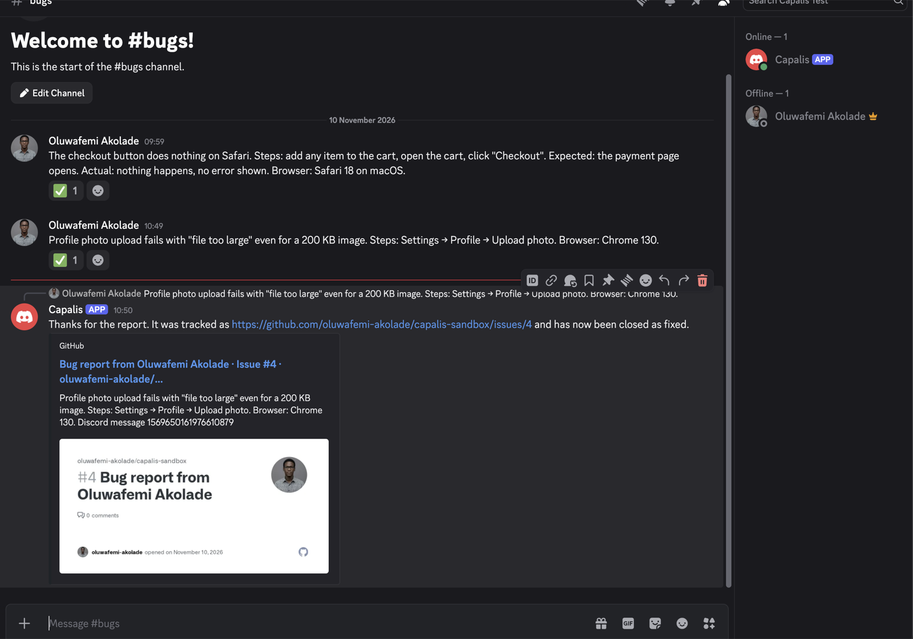
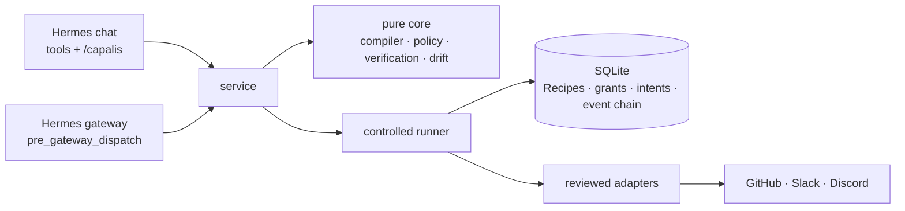

<div align="center">

# Capalis

**Agents that prove they're done.**

Capability intelligence and Verified Recipes for [Hermes Agent](https://github.com/NousResearch/hermes-agent).

[For judges](JUDGES.md) · [Owner's guide](docs/USER_GUIDE.md) · [For reporters](docs/REPORTERS.md) · [Architecture](docs/ARCHITECTURE.md) · [Security model](docs/SECURITY_MODEL.md) · [Demo script](docs/DEMO.md)

[](https://github.com/OWNER/capalis/actions/workflows/ci.yml)
[](LICENSE)


</div>

An agent that says "done" usually means a tool returned 200. The issue may be a duplicate, the message may have gone to the wrong place, and a retry after a timeout may have done it twice. Automations break silently when a token or an API changes, and nobody finds out until a customer does.

**Capalis turns a sentence into a workflow you approve once, and that proves every step it takes.**

1. **Describe it.** "When someone posts a bug in #bugs, open an issue in my-app, tell #engineering, and let the reporter know when it's fixed." Capalis compares the capabilities that could do each step and recommends the one whose result can be checked. Ask, and it shows you the comparison.
2. **Approve it once.** It builds a **Recipe**: a fixed, versioned plan that can only write where you approved. It runs the Recipe in **shadow** first (real reads, nothing sent), then waits for you to press **Approve**.
3. **It runs, and proves it.** Every write is read back from GitHub, Slack or Discord by a separate check before it counts. It never creates a duplicate and never blindly retries. If something it depends on changes, it stops itself and tells you.

<table>
<tr>
<td width="50%"><br/><sub>The reporter's Discord message gets a reply when the issue is closed</sub></td>
<td width="50%"><br/><sub><code>/capalis evidence</code>: each write and the independent check that proved it</sub></td>
</tr>
</table>

## For judges (5 minutes)

1. **Read the claims:** [JUDGES.md](JUDGES.md) lists each claim with the tests that prove it and a results file generated from a real run. All of them hold.
2. **See the live run:** the screenshots above and in [docs/assets](docs/assets) come from the owner's own accounts:
   - a Discord report became issue #4;
   - Slack was notified;
   - the issue was closed and the reporter got a reply;
   - all three writes were read back (`met`) and the run is `verified`.
3. **Run it yourself in seconds:** `uv sync --group dev && make check` runs lint, strict typing and 276 test cases. No accounts are needed.
4. **Try the dangerous cases:**
   - [`tests/integration/test_runner.py`](tests/integration/test_runner.py) crashes mid-write, lies about success, revokes approval mid-run and injects hostile text.
   - [`tests/property`](tests/property) generates hostile payloads.
5. **Read on:**
   - [How it works](docs/ARCHITECTURE.md)
   - [The twelve invariants and where each is enforced](docs/SECURITY_MODEL.md)
   - [Why it's built this way](docs/DECISIONS.md)
   - [FAQ](docs/FAQ.md)

## What is real, and what is simulated

| Real | Simulated, by design | Not built yet |
| --- | --- | --- |
| A Hermes v0.23.0 plugin that passes `hermes plugins validate` and `doctor` | Shadow runs simulate writes; that's their purpose | Triggers from Slack channels |
| Real Hermes chats (gpt-6.1-sol via Codex) building, compiling and shadow-qualifying Recipes through the tools | In-memory providers in `tests/fakes.py`, used only to inject faults real services can't produce on demand | Alerts to the owner |
| GitHub, Slack and Discord on the owner's sandbox accounts, including the full report-to-reply loop | | Running other plugins' tools inside Recipes ([roadmap](docs/ROADMAP.md)) |
| Discord intake through the Hermes gateway | | |

## How people use it

**Teammates who report bugs** post in the channel as they would to a person, and get replies under their message. That's all ([guide](docs/REPORTERS.md)).

**The owner** sets it up once by chatting, with no ids and no code ([guide](docs/USER_GUIDE.md)):

```text
/capalis setup                       what is connected, and the exact fix for anything that is not
"Set up a Recipe: when @ada posts in #bugs, open an issue in my-app, tell #engineering,
 and reply to her when it's closed."
/capalis approve bug-reports         a plain summary and [Approve] [Not now]
```

| Command | |
| --- | --- |
| `/capalis` | Status: Recipes, recent runs, anything that needs you |
| `/capalis setup` | Readiness check with the exact fix for each gap |
| `/capalis show <recipe>` | Every step, target, check and limit, with names next to ids |
| `/capalis approve <recipe>` | Approve with a button, bound to the version shown |
| `/capalis runs`, `/capalis evidence <run>` | What happened, and the independent checks behind it |
| `/capalis pause`, `/capalis resume` | Stop and restart future writes |
| `/capalis revoke <recipe>` | Withdraw approval |
| `/capalis confirm <run> <step>`, `/capalis resolve <run> <step> applied\|not-applied` | Answer when Capalis asks |

The model can pause, but it can never approve, resume, revoke, confirm or resolve.

## How it stays safe

- **Fixed targets.** Where a Recipe writes is set when it's compiled. Report text is data and never chooses a target or a step.
- **Approval bound to a version.** A new version needs a new approval, and an approval expires and can be revoked.
- **Checked before every write:** approval, pause, budgets, rate and the capability's pinned shape.
- **No blind retries.** Each write is journaled before it's sent. An uncertain write is looked up by its key; "not found" counts only after a settle window.
- **Verified means observed.** A tool's own "success" never counts.
- **Drift quarantine.** A changed token, permission or API shape stops the Recipe before its next write.
- **Redacted, tamper-evident records.** Credentials never reach the database, and the event log is hash-chained.

Details: [docs/SECURITY_MODEL.md](docs/SECURITY_MODEL.md).

## Architecture



The pure core has no Hermes, network or file imports, and a test enforces that. More in [docs/ARCHITECTURE.md](docs/ARCHITECTURE.md).

## Install

```bash
hermes plugins install OWNER/capalis#plugin
hermes plugins enable capalis
```

Then follow the [owner's guide](docs/USER_GUIDE.md). Credentials go in Hermes Desktop (**Settings → Plugins → Capalis**) or `hermes config set`. Capalis reads them only through Hermes and never from files.

## What it touches

- **Network:**
  - `api.github.com`, `slack.com` and `discord.com`, with your tokens;
  - a Slack webhook URL, if you set one;
  - credential-free `GET` requests to HTTPS origins an approved Recipe names.

  There is no telemetry.
- **Storage:** one SQLite file under Hermes's `plugin-data/capalis/`, holding Recipes, approvals, runs and redacted payloads.
- **Messages:** Capalis consumes the messages in a channel a Recipe listens to, so the agent doesn't reply there.
- **Background work:** a daemon thread in the gateway that advances parked runs every 30 seconds. No shell commands, subprocesses or self-updating.

## Limits

- Only Capalis's reviewed adapters run inside Recipes:
  - GitHub Issues,
  - Slack (bot, plus an unverifiable webhook),
  - Discord,
  - HTTPS GET.
- Slack incoming webhooks can't be read back, so Capalis never recommends them where a check is required.
- Waits poll every 30 seconds or more.
- The HTTPS check for a deployed version is tested, but hasn't been run against a real deployment.
- The hash chain detects edited or deleted events; it doesn't stop someone who rewrites the whole database.

## Development

```bash
make install    # uv sync --group dev
make check      # ruff, mypy --strict, pytest
make judge      # regenerate JUDGES.md + docs/results/<date>.json from a fresh run
make e2e        # opt-in live run on your own sandbox accounts
```

```text
plugin/                  the Hermes plugin (what gets installed)
  plugin.yaml            manifest: 6 tools, 1 hook, settings
  capalis/core/          pure, deterministic: compiler, policy, lifecycle, verification, drift, matching
  capalis/storage/       SQLite store with migrations and the event chain
  capalis/runtime/       controlled runner and adapter protocol
  capalis/adapters/      GitHub, Slack, Discord, HTTPS; name lookups; chat surfaces
  capalis/service.py     application service (no Hermes imports)
  capalis/hermes.py      Hermes glue: storage, secrets, gateway intake
tests/                   unit, property, integration, opt-in live
scripts/judge_report.py  generates JUDGES.md from a real run
docs/                    guides, architecture, security model, decisions, results
```

[Testing](docs/TESTING.md) · [Decisions](docs/DECISIONS.md) · [Roadmap](docs/ROADMAP.md) · [Changelog](CHANGELOG.md) · [Security policy](SECURITY.md)

## License

[MIT](LICENSE)
