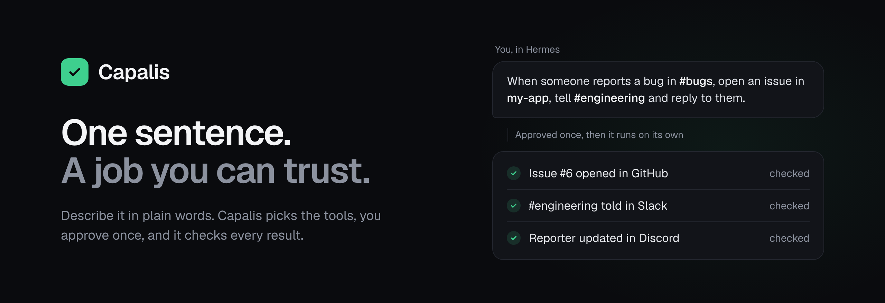
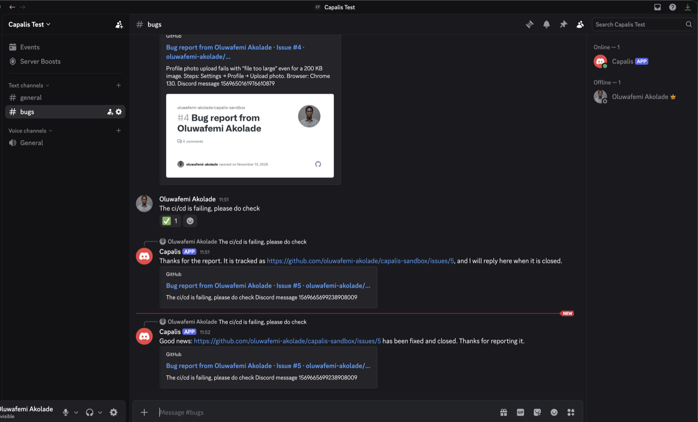
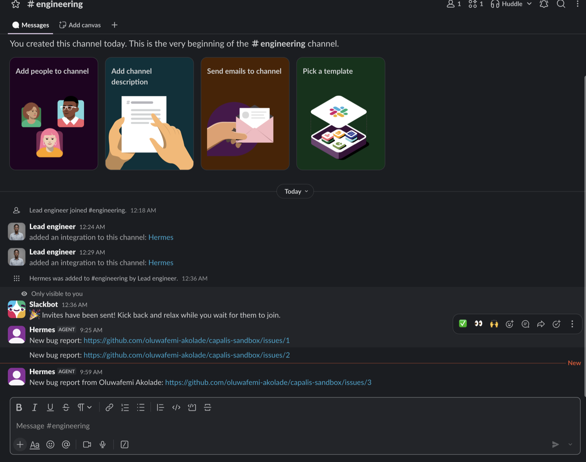
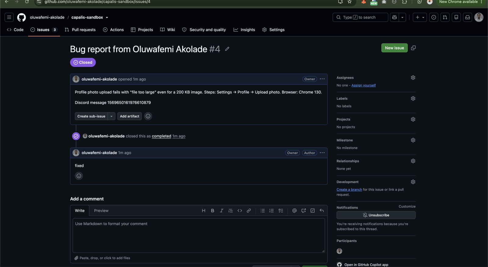
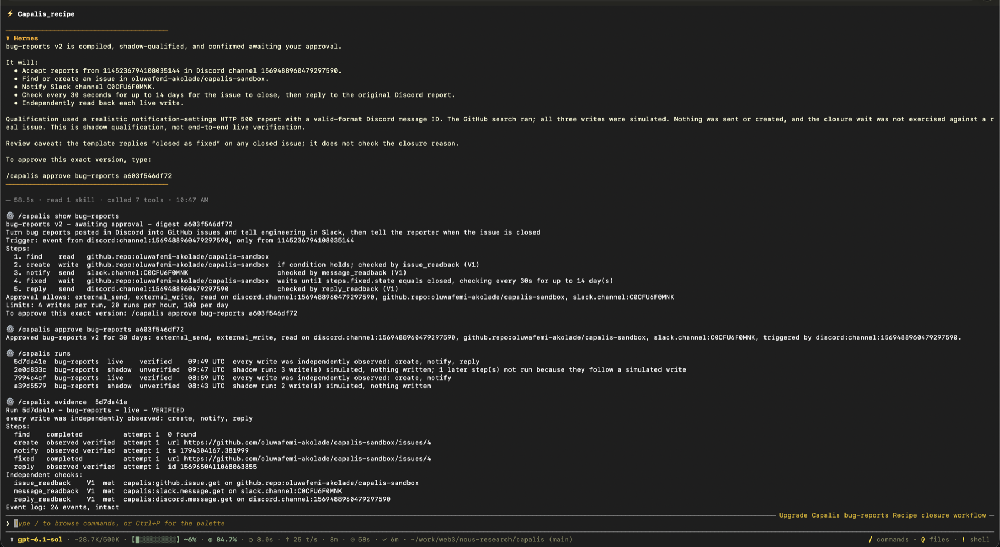
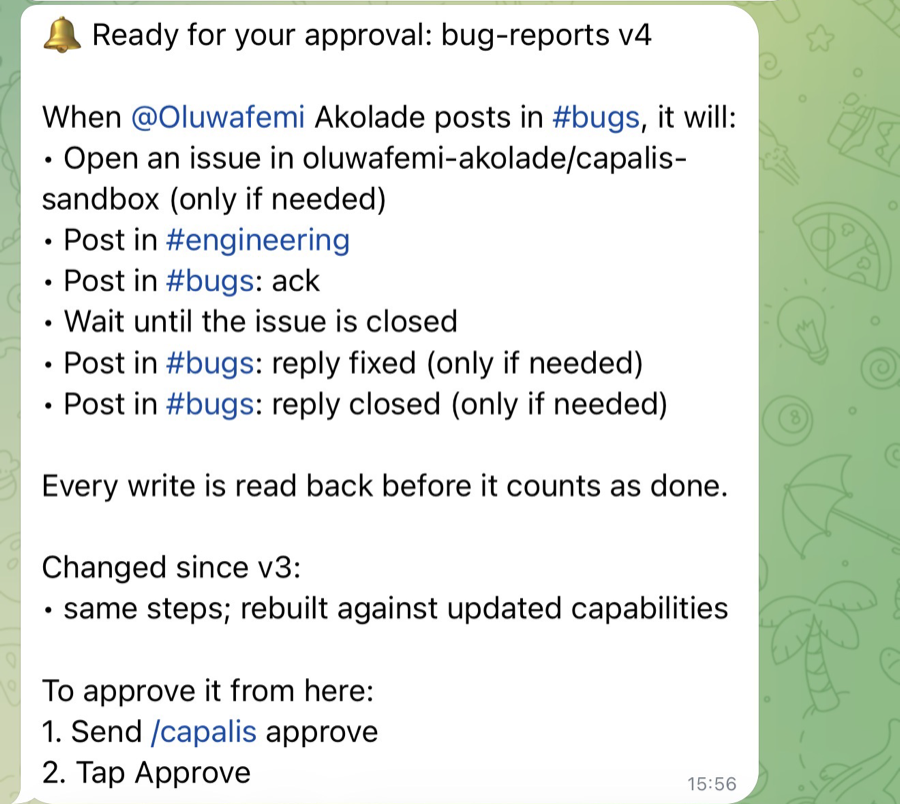
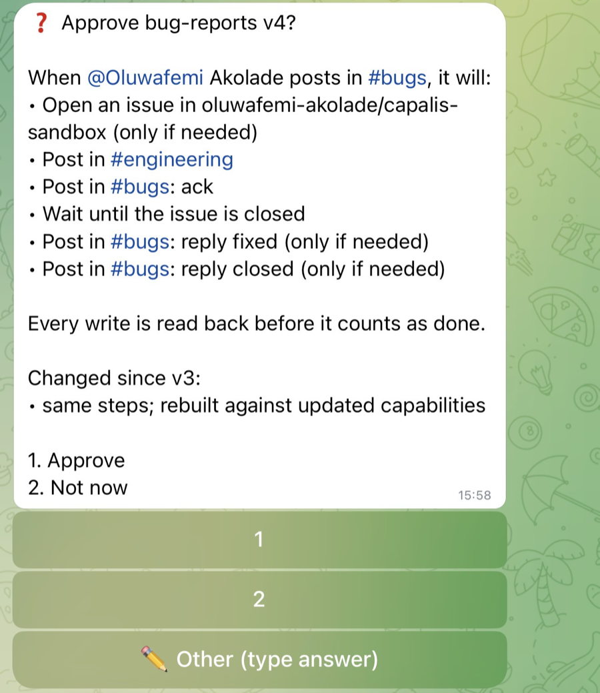
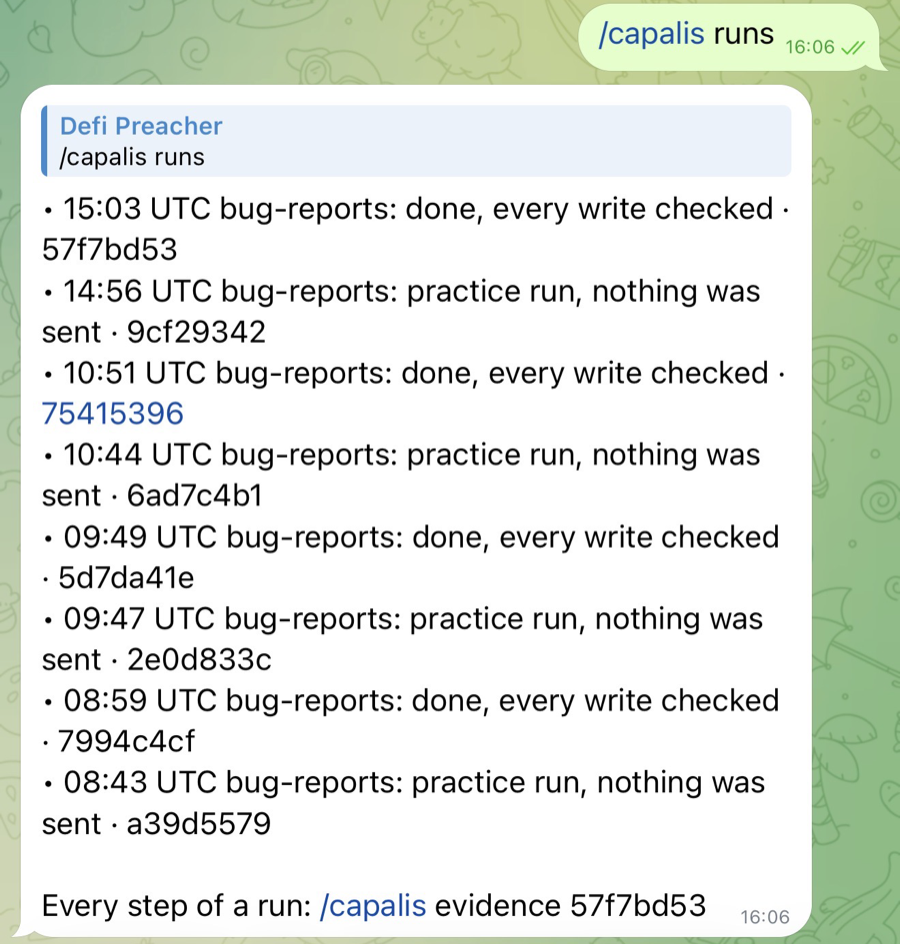
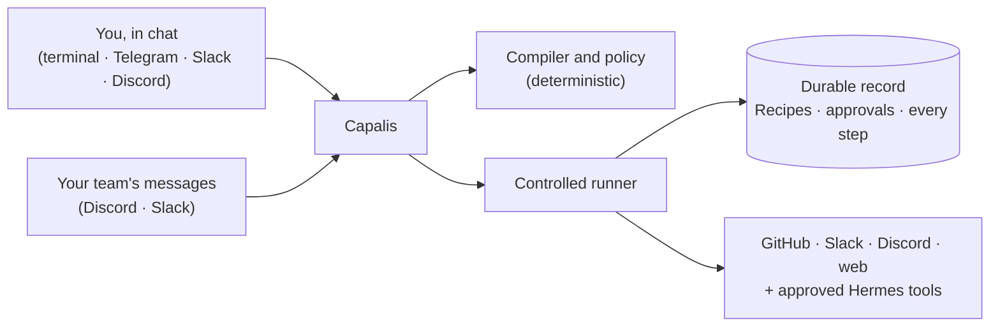

<div align="center">



### Describe a job once. Capalis sets it up, runs it, and checks it really happened.

Capalis is a plugin for [Hermes Agent](https://github.com/NousResearch/hermes-agent). Say what you want in plain words. It picks the right tools, you approve once, and the job runs on its own. Every result is checked where it landed, and the job stops itself if anything it depends on changes.

**[Quick start](#quick-start)** &nbsp;·&nbsp; **[See it work](#see-it-work)** &nbsp;·&nbsp; **[For judges](#for-judges)** &nbsp;·&nbsp; **[Owner's guide](docs/USER_GUIDE.md)**

[](https://github.com/Femtech-web/Capalis/actions/workflows/ci.yml)
[](https://github.com/NousResearch/hermes-agent)
[](LICENSE)

</div>

---

## Table of contents

- [The problem, in 20 seconds](#the-problem-in-20-seconds)
- [What changes with Capalis](#what-changes-with-capalis)
- [What makes it different](#what-makes-it-different)
- [See it work](#see-it-work)
- [Quick start](#quick-start)
- [Your phone is the control panel](#your-phone-is-the-control-panel)
- [Who it's for](#who-its-for)
- [For judges](#for-judges)
- [Proof: what ran for real](#proof-what-ran-for-real)
- [How it works](#how-it-works)
- [What it will never do](#what-it-will-never-do)
- [Using other Hermes tools](#using-other-hermes-tools)
- [Commands](#commands) (and [what it touches](#what-it-touches-disclosure))
- [Engineering decisions & the hard problems](#engineering-decisions--the-hard-problems)
- [What's real, and what's simulated](#whats-real-and-whats-simulated)
- [Limits](#limits)
- [Project layout and development](#project-layout-and-development)
- [Docs](#docs)

## The problem, in 20 seconds

You want one simple job done across your apps: *"When a customer reports a bug, open a ticket and tell the team."*

**Setting it up is the first wall.** Which tool does what? What's the channel's id? Which permissions? Most people give up, or hand the job to an AI agent.

**Trusting it is the second.** The agent answers **"Done ✅"**. But the ticket duplicates yesterday's, the message went to the wrong channel, and a network hiccup posted it twice. Next week a token expires, the job quietly stops, and the agent keeps saying "Done".

Capalis removes both walls. Setting a job up is a conversation, and "done" means it actually happened.

## What changes with Capalis

| Without Capalis | With Capalis |
| --- | --- |
| You need to know which tool, which ids and which permissions | **Say it in plain words.** Capalis finds #bugs and my-app by name and works out the steps |
| You guess which tool to use | **It recommends one and says why**, or you compare the options first. For example, a Slack webhook can't be read back, so it suggests the Slack bot. When the evidence is too thin to pick, it says so instead of ranking. |
| You re-explain the job every time | **Say it once, approve it once**, and it runs on its own |
| "Done" means the tool said OK | **"Verified"** means GitHub, Slack or Discord confirmed it, read back by a separate check. If it can't check, it says so. |
| A retry after a timeout does it twice | Every action is written down first and looked up before any retry. **Never twice.** |
| A changed token or API breaks silently | It notices, **stops itself**, and tells you on your phone |
| One sneaky message can redirect the agent | Where it acts is **fixed when you approve**; what people type can't change it |
| You can't tell what it actually did | One command shows **every step and the proof behind it** |

## What makes it different

Many agent tools now check a single action after the fact: did the payment land, did the message post. Capalis checks too, but checking is the smallest part. It owns the whole job:

- **It builds the job.** One sentence becomes a Recipe: the steps, fixed destinations, limits, and a check for every write. You approve that exact version, and any change needs a new approval.
- **It runs the job without you.** A message in Discord or Slack, or a schedule, starts it. It waits for later events, like an issue being closed, and follows up, even across restarts.
- **It acts carefully.** Before every write it re-checks your approval, any pause, the limits and its dependencies, and writes its intent down first. An uncertain write is looked up, never repeated.
- **It stays honest over time.** When a token, a permission or a tool changes, the Recipe stops itself and asks you to rebuild it and approve again.
- **You run it from your phone.** Approvals, alerts and status all happen in Telegram.

## See it work

A teammate posts a bug in Discord. Capalis opens the issue, tells the team in Slack, thanks the reporter in seconds, and tells them again when the issue is closed. It reads every one of those back before calling it done.

<table>
<tr>
<td width="50%"><br/><sub><b>The reporter</b> gets "tracked as #5" in seconds, then "fixed and closed"</sub></td>
<td width="50%"><br/><sub><b>The team</b> gets the issue link in Slack</sub></td>
</tr>
<tr>
<td width="50%"><br/><sub><b>The tracker</b> gets one issue per report, never a duplicate</sub></td>
<td width="50%"><br/><sub><b>The owner</b> sees the proof behind every step</sub></td>
</tr>
</table>

## Quick start

From nothing to a job that runs on its own, in seven steps. Steps 1 to 3 happen once, on the computer that runs Hermes. After that you can do everything from your phone.

| Who | Does what | Where |
| --- | --- | --- |
| **You, once** | Install Capalis and connect your apps (steps 1–3) | Terminal, or Hermes Desktop |
| **You, for each job** | Describe it, check it, approve it (steps 4–6) | A Hermes chat, then Telegram |
| **Your teammates** | Post as they already do. They don't install anything. | Discord or Slack |
| **Capalis** | Runs the job, checks every write, and messages you only when you're needed | In the background |

**1. Install Capalis** (terminal)

```bash
hermes plugins install Femtech-web/Capalis#plugin
hermes plugins enable capalis
```

**2. Connect Hermes to your chat apps** (terminal)

```bash
hermes gateway setup     # choose Telegram, Discord and/or Slack; it walks you through creating each bot
hermes gateway install   # keeps Hermes running in the background, even after a restart
```

No bot yet? Making one takes a few minutes: [Telegram](docs/USER_GUIDE.md#telegram-bot) · [Discord](docs/USER_GUIDE.md#discord-bot) · [Slack](docs/USER_GUIDE.md#slack-bot). Then, once:
- On **Telegram**, open your new bot and press **Start**, so it's allowed to message you ([how](docs/USER_GUIDE.md#telegram-bot)).
- In **Slack**, type `/invite @your-bot` in every channel it should read or post in ([how](docs/USER_GUIDE.md#slack-bot)).

**3. Give Capalis its keys** (Hermes Desktop → **Settings → Plugins → Capalis**)

| Field | What to enter |
| --- | --- |
| GitHub token | A new fine-grained token for your repository, with **Issues: Read and write** ([how to get it](docs/USER_GUIDE.md#github-token)) |
| Slack, Discord and Telegram bot tokens | The same tokens you gave Hermes in step 2. One bot per app is enough. |
| Approvers | `["telegram:<your Telegram user id>"]`, so you can approve from your phone ([find your id](docs/USER_GUIDE.md#your-telegram-user-id)) |
| Alerts channel | `telegram:<your Telegram user id>` |

Your Telegram user id is the number you gave `hermes gateway setup`. Without Desktop, `hermes config set` sets each field ([owner's guide](docs/USER_GUIDE.md#3-give-capalis-its-keys)). Never paste a token into a chat. Every token, step by step: [Getting each token](docs/USER_GUIDE.md#getting-each-token-step-by-step).

**4. Describe the job** (any Hermes chat: the terminal or Desktop)

> Set up a Capalis Recipe called bug-reports: when Ada posts a bug in Discord #bugs, open an issue in my-app, tell #engineering in Slack, and keep the reporter updated until it's closed. Use recommended.

Capalis finds #bugs, #engineering and my-app by name and builds the Recipe. Then it does a practice run that reads for real but sends nothing.

**5. Check it's ready** (same chat)

```text
/capalis setup
```

Every line says **OK**, or **FIX** with the exact fix. For the channel where reports arrive, it also prints a Hermes command to run once. Hermes ignores messages there until you allow them:

```text
Capalis setup
  OK   GitHub: connected as your-name
  OK   Slack: connected as hermes in Your Team
  OK   Discord: can see #bugs
  NOTE Hermes gateway: Discord messages in #bugs (1569…) reach Capalis only if the gateway listens there and allows the reporters
       -> run: hermes config set DISCORD_FREE_RESPONSE_CHANNELS 1569… && hermes config set DISCORD_ALLOWED_USERS 1145… && hermes gateway restart
Everything needed is ready.
```

**6. Approve it** (Telegram)

A message arrives: **🔔 Ready for your approval: bug-reports v1**, listing exactly what it will do and where. Send `/capalis approve` and tap **1** (Approve). The approval covers only that version; any change needs a new one.

**7. That's it.** When Ada posts a bug in #bugs, the issue, the Slack message and the reply to Ada appear within seconds, and each one is verified. You manage everything from the same Telegram chat:

| You want to | Send |
| --- | --- |
| See what's happening | `/capalis` |
| See recent runs | `/capalis runs` |
| See the proof for a run | `/capalis evidence <run>` |
| Pause one job, or everything | `/capalis pause bug-reports` · `/capalis pause` |

Reports in Slack instead? Say "reports arrive in Slack #support", and replies go into each report's thread. Need a site check? "Check https://myshop.com/checkout every 10 minutes and tell #ops if it's down." The [owner's guide](docs/USER_GUIDE.md) covers schedules, team approvals and troubleshooting. Teammates who only report bugs need [one page](docs/REPORTERS.md).

## Your phone is the control panel

Connect Telegram, and Capalis talks to you there. These are from a real run (`57f7bd53`):

<table>
<tr>
<td width="33%"></td>
<td width="33%"></td>
<td width="33%"></td>
</tr>
<tr>
<td><sub><b>1.</b> Capalis messages you when a Recipe is ready, listing what it will do</sub></td>
<td><sub><b>2.</b> Send <code>/capalis approve</code> and tap <b>1</b> (Approve). The button approves only the version shown</sub></td>
<td><sub><b>3.</b> A bug was posted and fixed; <code>/capalis runs</code> shows every write checked</sub></td>
</tr>
</table>

You get messages on your phone in three cases:
- a Recipe needs your approval;
- something it depends on changed, so it quarantined itself;
- a run is waiting for you or couldn't finish.

Each message comes with the exact command to type. The same `/capalis` commands work in your Hermes chat on Telegram as in the terminal.

## Who it's for

Anyone whose work runs through chat and who is tired of things falling through the cracks. Setup is a conversation, and approving is a button.

| Who | What they set up | Ready-made? |
| --- | --- | --- |
| **Support and community teams** (Discord servers, customer Slack channels) | Reports become tracked issues; the reporter is thanked, then told when it's resolved | Yes |
| **Agencies and freelancers** | Client reports in a shared Slack channel become issues in the client's repository, with replies in the thread | Yes (Slack intake) |
| **Small businesses and site owners** | "Check my checkout page every 10 minutes and tell #ops if it's down" | Yes (site watch) |
| **Open-source maintainers** | Community reports become one issue each, even when people repeat themselves | Yes |
| **Product teams** | Feedback from a channel becomes issues, and the requester hears back when it ships | Describe it |
| **Anyone** | "Every weekday at 9, post X in #standup" or "read this file and post a summary" | Describe it (schedules, [other Hermes tools](#using-other-hermes-tools)) |

## For judges

1. **Claims:** [JUDGES.md](JUDGES.md) lists every claim with the tests that prove it, regenerated from a real run. All of them hold.
2. **Live proof:** [Proof](#proof-what-ran-for-real) lists seven verified runs on real GitHub, Slack, Discord and Telegram accounts.
3. **Run the suite:** `uv sync --group dev && make check` runs lint, strict typing and 305 tests in about 5 seconds, with no accounts needed.
4. **Try to break it:** [`tests/integration/test_runner.py`](tests/integration/test_runner.py) crashes mid-write, fakes a success, revokes approval mid-run, changes a dependency and feeds hostile text.
5. **Read how it's built:**
   - [Architecture](docs/ARCHITECTURE.md)
   - [Security model](docs/SECURITY_MODEL.md) (twelve invariants, each tied to a test)
   - [Decisions](docs/DECISIONS.md)
   - [Engineering decisions & the hard problems](#engineering-decisions--the-hard-problems)

## Proof: what ran for real

These ran on the owner's own accounts on 2026-11-10, driven through a real Hermes chat and the Hermes gateway.

| Run | What happened | Independent checks |
| --- | --- | --- |
| automated e2e | Practice run (nothing sent), then live: issue #2 and a Slack notice; a duplicate delivery was ignored | 2 of 2 met |
| `7994c4cf` | A Discord post became issue #3, and Slack linked it | 2 of 2 met, **verified** |
| `5d7da41e` | … then the owner closed the issue, and Capalis replied under the report | 3 of 3 met, **verified** |
| `75415396` | A change to the GitHub capability quarantined the old version by itself; the model rebuilt it from names only; issue #5 → Slack → "tracked as #5" → closed → "fixed and closed" | 4 of 4 met, **verified** |
| `57f7bd53` | **Approved from a phone.** The Telegram approval request arrived 9 seconds after the practice run; the owner approved with a button; then issue #6 → Slack → "tracked as #6" → closed → "fixed and closed" | 4 of 4 met, **verified** |
| `3d1687c0` | **Reports from Slack.** A post in Slack #support became issue #7; #engineering was told; the reply landed in the report's thread | 3 of 3 met, **verified** |
| `7a2fa863` | **Site watch on a schedule.** Every 2 minutes it checked a page; the page answered 404, so #ops was told; then the owner paused it from Telegram | 1 of 1 met, **verified** |

## How it works



- **A model drafts; code decides.** A deterministic compiler checks every step against reviewed capabilities, fixes every destination as a constant, and requires an independent check for every write. The result is a versioned Recipe identified by its fingerprint.
- **Before every write**, Capalis re-checks your approval, any pause, the limits, and whether anything it depends on changed. It writes the action down, and only then does it.
- **After every write**, a separate call reads the result back. If they disagree, the step fails and nothing after it runs.
- **If the outcome is uncertain** (a timeout, a crash), it looks the action up instead of repeating it. If it can't look it up, it asks you.
- **Waiting** (for an issue to close, or the next scheduled run) survives restarts.

Details: [docs/ARCHITECTURE.md](docs/ARCHITECTURE.md).

## What it will never do

- **Act anywhere you didn't approve.** Destinations are fixed when you approve, and what people type can't change them.
- **Approve its own work.** Only you can approve, resume, revoke, confirm or resolve. The AI can propose, practice and pause.
- **Call a tool's "OK" proof.** Anything not read back is labeled "unverified", with the reason.
- **Do it twice.** Each trigger runs once, and an uncertain action is looked up, not repeated.
- **Keep going after something changed.** A changed token, permission or API stops the Recipe before its next action.
- **Keep your secrets.** Credentials come only from Hermes, and everything is redacted before it's stored.

## Using other Hermes tools

Capalis's own connections cover GitHub, Slack, Discord, Telegram and web pages. Any other Hermes tool, built-in or from another plugin, can join a Recipe as a step or as an independent check:

1. The model proposes a **contract** for it: what the tool takes, what it returns, and that it only reads.
2. You run `/capalis contract test <tool>`, which makes one real call through Hermes and checks the result.
3. You approve it with `/capalis contract approve <tool>`.

Change the contract and it needs approval again. Revoke it, and every Recipe using it stops. Tools that change things are refused until they can be tested safely in a sandbox.

## Commands

| | |
| --- | --- |
| `/capalis` · `/capalis setup` | Status · readiness check with exact fixes |
| `/capalis show <recipe>` · `/capalis approve [recipe]` | Review (including what changed) · approve with a button |
| `/capalis runs` · `/capalis evidence <run>` · `/capalis export <run>` | What happened · the proof · a reviewer bundle |
| `/capalis pause` · `resume` · `revoke <recipe>` · `cancel <run>` | Stop things |
| `/capalis contract test\|approve\|revoke <tool>` | Bring another Hermes tool into Recipes |
| `/capalis prefer recommend\|compare\|ask` | How options are presented to you |

### What it touches (disclosure)

- **Network:**
  - `api.github.com`, `slack.com`, `discord.com` and `api.telegram.org`, with your tokens;
  - a Slack webhook, if you set one;
  - credential-free HTTPS `GET`s to sites an approved Recipe names.

  There is no telemetry.
- **Other Hermes tools:** only those whose read-only contract you tested and approved, called through `ctx.dispatch_tool`.
- **Storage:** one SQLite file in Hermes's `plugin-data/capalis/` (Recipes, approvals, runs, redacted payloads), plus evidence exports in `plugin-data/capalis/exports/`. Capalis never reads `.env`, `auth.json` or other tools' credentials.
- **Messages:**
  - It consumes the messages in channels a Recipe listens to, so the agent doesn't reply there.
  - It sends alerts and approval requests to the Alerts channel you set.
- **Background work:** a thread in the Hermes gateway advances waiting runs, fires schedules, checks for changes and sends alerts every 30 s. No shell commands, subprocesses or self-updating.

## Engineering decisions & the hard problems

- **The live run found what fakes couldn't.** The first real run looked up an issue it had created a second earlier, and GitHub's list didn't have it yet. Treating that as "never happened" would have licensed a duplicate. So "found" counts at once, and "not found" only counts after a 60-second settle window ([D-025](docs/DECISIONS.md)).
- **Hermes's guards don't cover plugin calls.** In v0.23.0, `ctx.dispatch_tool` calls handlers directly, without the agent loop's hooks or middleware. Capalis therefore re-checks policy itself before every write, and that's the boundary it claims ([D-016](docs/DECISIONS.md)).
- **Exactly-once isn't promised; reconciliation is.** Each write is journaled, then marked "dispatched" by compare-and-set, before the call. A crash afterwards leaves an "unknown effect" that is looked up, never re-sent. Remove that guard and a crash test finds two issues.
- **Discord has nowhere to hide a key.** Slack messages carry metadata, and GitHub issues can carry an HTML comment. Discord replies can't, so they're reconciled as *this bot's reply to that message with that text*, plus a nonce that lets Discord drop quick duplicates.
- **Telegram can't read back.** Telegram's Bot API has no call that reads a message back. So Telegram carries messages to you (alerts and approval requests) and is never used as proof.
- **A reply loop caught in design.** A reporter answering "thanks!" to Capalis's acknowledgement would have looked like a new bug. Replies and thread messages never start a run.
- **Strict drift, on purpose.** Any change to a pinned capability quarantines the Recipe, even a harmless one. That happened live when we added a field to GitHub issues. Rebuilding and re-approving took about a minute, and it's the only rule that can never silently adopt a breaking change.
- **Names for people, ids for Recipes.** People type "#bugs" and "@ada". Recipes pin ids, because names get renamed, and the approval screen shows both.

## What's real, and what's simulated

| Real | Simulated, by design | Not built yet |
| --- | --- | --- |
| A Hermes v0.23.0 plugin that passes `hermes plugins validate` and `doctor` | Practice (shadow) runs simulate writes; that's their purpose | Writes through other plugins' tools (read-only contracts only) |
| Real Hermes chats building, comparing, compiling and practicing Recipes | In-memory services in `tests/fakes.py`, used only to inject failures real services can't produce on demand | A dashboard page |
| GitHub, Slack and Discord on real accounts: the full report-to-reply loop, a live drift quarantine, Slack intake with threaded replies, and a scheduled site watch; Telegram alerts and phone approval | Scripted HTTP replies in adapter tests | Telegram as a place reports come *from* |

## Limits

- Writes go only through Capalis's reviewed connections: GitHub Issues, Slack, Discord and Telegram, plus HTTPS reads. Slack webhooks and Telegram can't be read back, so their posts are labeled unverifiable.
- Waits and schedules check every 30 seconds or more, and need the Hermes gateway running.
- Contracts for other Hermes tools pass their tests, but haven't run on the owner's accounts yet.
- For reports from Slack or Discord, Hermes itself must listen in that channel and allow the reporters. That's one setting each, set once by the owner. `/capalis setup` prints the exact commands; a plugin isn't allowed to change Hermes's settings.
- The record's hash chain detects edits; it can't stop someone who rewrites the whole database.

## Project layout and development

```text
plugin/                  the Hermes plugin (what gets installed)
  capalis/core/          pure and deterministic: compiler, policy, lifecycle, verification, drift, matching, cron, contracts
  capalis/storage/       SQLite store with migrations and a hash-chained event log
  capalis/runtime/       the controlled runner and the adapter protocol
  capalis/adapters/      GitHub, Slack, Discord, Telegram, HTTPS, other Hermes tools, name lookups, chat surfaces
  capalis/service.py     the application service (no Hermes imports)
  capalis/hermes.py      Hermes glue: storage, secrets, gateway intake
tests/                   unit, property, integration, opt-in live
```

```bash
make install   # uv sync --group dev
make check     # ruff, mypy --strict, pytest
make judge     # regenerate JUDGES.md and docs/results/<date>.json
```

CI runs lint, typing and tests on Python 3.11 and 3.13, plus a secret scan. The core has no Hermes, network or file imports, and a test enforces that.

## Docs

[Owner's guide](docs/USER_GUIDE.md) · [For reporters](docs/REPORTERS.md) · [FAQ](docs/FAQ.md) · [JUDGES.md](JUDGES.md) · [Architecture](docs/ARCHITECTURE.md) · [Security model](docs/SECURITY_MODEL.md) · [Testing](docs/TESTING.md) · [Decisions](docs/DECISIONS.md) · [Demo script](docs/DEMO.md) · [Roadmap](docs/ROADMAP.md) · [Changelog](CHANGELOG.md) · [Security policy](SECURITY.md) · [MIT license](LICENSE)
