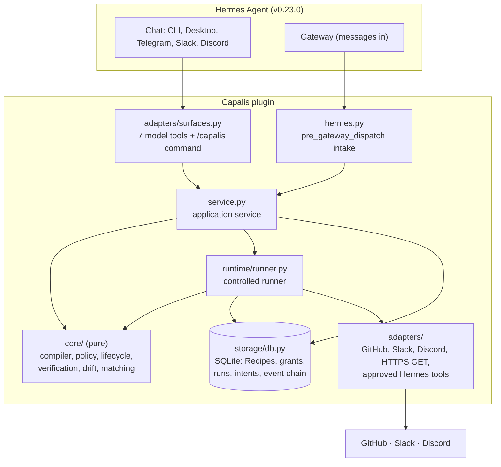
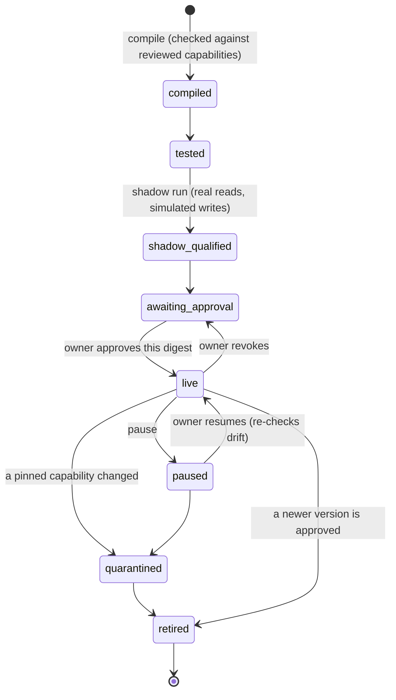

# Architecture

Capalis is a native Python plugin for Hermes Agent v0.23.0. It only uses documented plugin surfaces: `register_tool`, `register_command`, `register_hook("pre_gateway_dispatch")`, `ctx.ask_choice`, `plugin_db` and `agent.secret_scope.get_secret`. It ships no Python dependencies; everything runs on the standard library.

The design has one rule: **a language model may propose a Recipe, but deterministic code decides what runs.** A model drafts. The compiler checks the draft against reviewed capabilities. The owner approves one exact version. Then the runner executes only that version, and re-checks everything before each write.

## Layers



| Layer | Path | Depends on | Notes |
| --- | --- | --- | --- |
| Pure core | `plugin/capalis/core/` | nothing | Compiler, typed expressions, JSON-schema subset, lifecycle tables, policy, outcome contracts, drift, capability matching, redaction, wire format. A test forbids Hermes, network and file imports here. |
| Storage | `plugin/capalis/storage/db.py` | core | SQLite with migrations. All writes go through `BEGIN IMMEDIATE` transactions with compare-and-set state changes. Payloads are redacted before storage, and the event log is hash-chained. |
| Runtime | `plugin/capalis/runtime/` | core, storage | `ports.py` defines the adapter protocol (`ok / rejected / retryable / ambiguous`). `runner.py` is the only path from a Recipe to an effect. |
| Adapters | `plugin/capalis/adapters/` | runtime ports | The reviewed provider adapters, the capability catalog, name lookups (`directory.py`), text views (`render.py`) and the chat surfaces. |
| Application | `plugin/capalis/service.py` | everything above | Planning, compiling, qualifying, approving, controls, evidence and gateway intake. It has no Hermes imports, so it can be tested directly. |
| Hermes glue | `plugin/capalis/hermes.py`, `plugin/__init__.py` | Hermes public API | Builds the service lazily on first use, reads secrets through Hermes and maps gateway events to triggers. |

## A Recipe's life



Versions are immutable. A Recipe is stored as its wire form under its SHA-256 digest. It is reloaded from that form, never recompiled, so a change in the outside world shows up as drift rather than being silently adopted.

## One run, from message to verified

```mermaid
sequenceDiagram
  participant R as Reporter (Discord)
  participant G as Hermes gateway
  participant C as Capalis
  participant GH as GitHub
  participant S as Slack

  R->>G: "Checkout button does nothing"
  G->>C: pre_gateway_dispatch(event)
  C->>C: admit: source, sender, payload schema, rate, dedupe (durable run row)
  C-->>G: skip (the agent stays quiet in that channel)
  C->>GH: search issues (read)
  C->>C: re-check approval, pause, pins; journal write intent
  C->>GH: create issue (key embedded)
  C->>GH: read the issue back (independent check)
  C->>S: post notice (key in message metadata)
  C->>S: read the message back
  C->>R: "Thanks, tracked as #12" (read back)
  Note over C: park; poll every 30 s until the issue is closed
  C->>R: "Fixed and closed" (read back)
  C->>C: run = verified only if every check was met
```

### Before every write

1. Re-read the Recipe's state, the global pause and the active approval. Then check the step against the approval's effects, targets, trigger source, write budget and per-run confirmations (`core/policy.py`).
2. Re-compute drift against the live capability descriptors. Any change blocks the write and quarantines the Recipe.
3. Resolve inputs only from the stored, redacted payload and stored step outputs. Check the target against the approved one, and validate the inputs against the capability schema.
4. Record the intent (`intent_recorded`), then mark it `dispatched` with a compare-and-set **before** calling the provider.

### When the outcome is uncertain

An attempt left in `dispatched` by a crash or timeout becomes `unknown_effect` and is never re-sent. Reconciliation then looks it up with the provider:
- GitHub: a hidden marker in the issue body.
- Slack: message metadata.
- Discord: this bot's reply to the same message with the same text.

If it's found, the run continues from the real resource. "Not found" counts only after a 60 s settle window, because provider lists lag behind writes; only then may a new attempt retry. With no lookup available, the run stops in `needs_reconciliation` until the owner answers.

### Verification

Each write names an outcome contract: a separate read-only probe, its inputs and the expected fields. The level is fixed at compile time:
- **V1:** same system, independent read.
- **V2:** a different system.
- **V0:** the tool's own reply. It never counts.

A disagreement (`not_met`) fails the step at once and blocks its dependents. Probe errors are retried until the contract's deadline; after that the step is `unverified`. A run is `verified` only when every write's required checks were met.

## Beyond one run

- **Schedules.** A pure cron (`core/cron.py`, UTC). The worker fires live schedule Recipes. Each slot's minute is its dedupe value, so it fires once across workers and restarts; counting starts at approval, and after downtime only the latest missed slot fires.
- **Owner alerts.** A cursor over the event log turns events that need a person into one message each, posted to the owner's chosen channel. The cursor advances only after delivery and starts at "now" when alerts are enabled.
- **Other Hermes tools** (`core/contracts.py`, `adapters/hermes_tools.py`). An owner-approved capability contract turns one of Hermes's own read tools (`web_search`, `web_extract`: the `READ_TOOLS` allowlist) into a `hermes:<tool>` capability, called through `ctx.dispatch_tool`. A proposal is inert. The test shows its exact inputs and runs only when the owner confirms that contract version. Approval is an owner command, practice runs simulate the call, and any change returns the contract to "proposed".
- **Public addresses only** (`adapters/net_safety.py`). The credential-free web read refuses private, loopback, link-local, carrier-grade NAT, reserved and multicast addresses at compile time, before each request, and at connect time, where it connects only to the checked address and ignores proxies.
- **Versions.** `core/diff.py` explains what changed since the previous version. That diff appears in `show`, in compile results and in the approval summary.
- **Export and import.** Evidence bundles (Markdown and JSON). Recipes travel as `capalis-recipe/1` with their digest: an import is verified, rebuilt from the wire form against the importer's capabilities, and starts unapproved.

## Data

| Table | Holds |
| --- | --- |
| `recipes` | Immutable versions (wire form, digest, state, reason) |
| `grants` | Approvals: digest, effects, targets, trigger sources, expiry, revocation |
| `runs` | One per trigger, unique on (recipe, mode, dedupe value); stored redacted payload, lease, resume time |
| `step_attempts` | Every attempt: idempotency key, effect, target, state, redacted output |
| `observations` | Every independent check, with its verdict |
| `confirmations`, `controls`, `preferences`, `names` | Per-run confirmations, global pause, alert and schedule cursors, presentation preference, display names |
| `contracts` | Capability contracts for other Hermes tools: proposed → tested → approved (or revoked) |
| `events` | Append-only, hash-chained, redacted audit log |

## Hermes integration points

| Surface | Used for | Source in v0.23.0 |
| --- | --- | --- |
| `ctx.register_tool` | 7 model tools (deferred, loaded through Tool Search) | `hermes_cli/plugins.py` |
| `ctx.dispatch_tool`, `ctx.has_plugin` | Running `web_search` or `web_extract` under an approved contract | `hermes_cli/plugins.py` |
| `ctx.register_command` + `ask_choice` | `/capalis` and its Approve / Not now buttons | `hermes_cli/plugins.py`, `hermes_cli/plugin_choices.py` |
| `pre_gateway_dispatch` hook | Messages in a Recipe's channel become triggers | `website/docs/user-guide/features/hooks.md` |
| `plugins.plugin_storage.plugin_db` | The SQLite file under `plugin-data/capalis/` | `plugins/plugin_storage.py` |
| `agent.secret_scope.get_secret` | Every credential read (catalog rule 11) | `agent/secret_scope.py` |

Capalis does **not** use `ctx.dispatch_tool` for Recipe steps. In v0.23.0 it calls the handler directly, and the agent loop's hooks and middleware don't run (see [DECISIONS.md](DECISIONS.md), D-016). That leaves Capalis's own runner as the enforcement boundary for the steps it manages.
