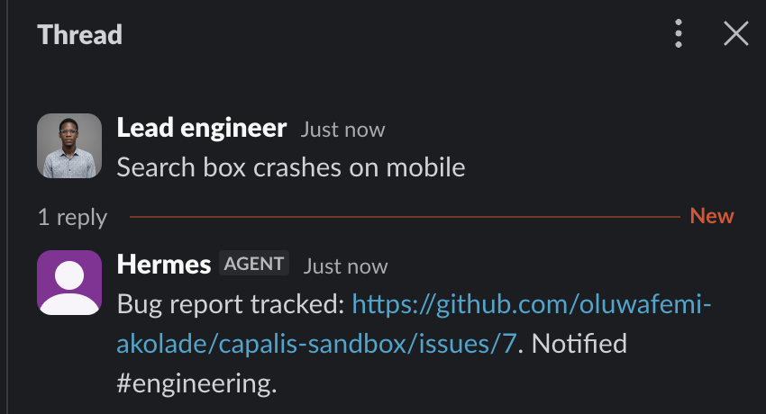

# Owner's guide

For the person who sets Capalis up for a team. No programming is needed. You chat with Hermes, and you approve by pressing a button or typing one command. Teammates who only report bugs need [REPORTERS.md](REPORTERS.md).

## What you will end up with

A **Recipe**: a small, approved workflow that runs on its own. For example:

> When someone posts a bug in Discord **#bugs**, open a GitHub issue in **my-app** (unless one already mentions it), tell engineering in Slack **#engineering**, thank the reporter, and tell them again when the issue is closed.

Capalis never does anything you haven't approved. It checks every write by reading it back, and it tells you plainly when something couldn't be checked.

## 1. Install (once)

```bash
hermes plugins install Femtech-web/Capalis#plugin
hermes plugins enable capalis
```

## 2. Connect Hermes to your chat apps (once)

Capalis talks to people through Hermes's own connections, so connect the apps you use first:

```bash
hermes gateway setup     # choose Telegram, Discord and/or Slack; it asks for each app's bot token
hermes gateway install   # keeps Hermes running in the background, even after a restart
```

`hermes gateway setup` asks for a bot token for each app you choose. If you don't have one yet, making a bot takes a few minutes: [Telegram](#telegram-bot) · [Discord](#discord-bot) · [Slack](#slack-bot).

Hermes has to keep running for waiting jobs, schedules and alerts, which is why `install` matters. Then, once:
- On **Telegram**, open your new bot and press **Start**, so it's allowed to message you ([step 5 here](#telegram-bot)).
- In **Slack**, type `/invite @your-bot` in every channel it should read or post in ([step 5 here](#slack-bot)).
- In **Discord**, the invite link from `hermes gateway setup` adds the bot to your server ([step 4 here](#discord-bot)).

## 3. Give Capalis its keys

The easiest place is Hermes Desktop: open **Settings → Plugins**, then click the gear next to **Capalis**. Add only what you use, and never paste a token into a chat. Each row links to step-by-step instructions.

| Field | What to enter | Stored as |
| --- | --- | --- |
| GitHub token | A fine-grained token limited to your repositories, with **Issues: Read and write** ([how to get it](#github-token)) | `CAPALIS_GITHUB_TOKEN` |
| Slack bot token | The bot token Hermes uses, from step 2 ([how to get it](#slack-bot)). It needs `chat:write`, `channels:read`, `channels:history` and `users:read`; an app made from Hermes's manifest has them. | `CAPALIS_SLACK_BOT_TOKEN` |
| Discord bot token | The bot token Hermes uses ([how to get it](#discord-bot)). In your channel it needs **View Channel**, **Send Messages** and **Read Message History**, and the **Message Content** intent on. | `CAPALIS_DISCORD_BOT_TOKEN` |
| Telegram bot token | The bot token Hermes uses: your phone's control panel ([how to get it](#telegram-bot)) | `CAPALIS_TELEGRAM_BOT_TOKEN` |
| Approvers | Who may approve from chat, for example `["telegram:123456789"]` ([find your id](#your-telegram-user-id)) | setting |
| Alerts channel | Where Capalis tells you when you're needed: `telegram:123456789` is best, because it's your phone. `slack:#ops` and `discord:#ops` work too. | setting |

Your Telegram user id is a number, not your @username. It's the one you gave `hermes gateway setup`, and it's also in Hermes's `TELEGRAM_ALLOWED_USERS` setting. [Here's how to find it](#your-telegram-user-id).

Without Desktop, use the terminal. Tokens go to Hermes's `.env`; settings go to its `config.yaml`:

```bash
hermes config set CAPALIS_GITHUB_TOKEN <token>
hermes config set plugins.entries.capalis.settings.approvers '["telegram:123456789"]'
hermes config set plugins.entries.capalis.settings.alert_channel telegram:123456789
```

The alerts channel gets one message whenever something needs a person: a Recipe ready for approval, a Recipe that stopped itself, a write it couldn't check, a step waiting for confirmation, or a failed run. Each message includes the exact command to type.

## 4. Describe what you want

Ask in plain words, using names, not ids:

> Set up a Capalis Recipe called bug-reports: when @ada or @sam post in Discord #bugs, open an issue in my-app, notify #engineering in Slack, and tell the reporter when the issue is closed. Use the recommended options.

Hermes shows what each name resolved to (for example "#bugs is channel 1569… in Your Team"). It then builds the Recipe and runs it once in **shadow mode**: reads are real, writes are only simulated, and nothing is sent anywhere.

Reports in Slack instead? Say "reports arrive in Slack #support", and replies go into each report's thread:



Not about bugs? There's a ready-made **site watch** too:

> Check https://myshop.com/checkout every 10 minutes and tell #ops in Slack if it's down.

When the page doesn't answer normally, #ops hears about it, once per check, until you fix it or pause the watch (`/capalis pause <name>`):


If you want to choose between options, say "compare first". To make that your default, type `/capalis prefer compare` (or `recommend`). For example, Capalis will explain that a Slack incoming webhook is simpler but its posts can't be read back, while the Slack bot's can.

## 5. Check everything is ready

In the same chat, type:

```
/capalis setup
```

Each line says **OK**, **FIX** (with the exact fix) or **NOTE**:

```
Capalis setup
  OK   GitHub: connected as your-name
  OK   Slack: connected as hermes in Your Team
  FIX  Slack: #engineering: the Capalis bot is not in this channel yet
       -> in Slack, open #engineering and type /invite @ followed by the bot's name
  OK   Discord: can see #bugs
  NOTE Hermes gateway: Discord messages in #bugs (1569…) reach Capalis only if the gateway listens there and allows the reporters
       -> run: hermes config set DISCORD_FREE_RESPONSE_CHANNELS 1569… && hermes config set DISCORD_ALLOWED_USERS 1145… && hermes gateway restart
1 thing(s) to fix.
```

**Why the NOTE matters.** Hermes ignores channel messages that don't @mention its bot, and messages from people it doesn't know, before any plugin sees them. So, once per report channel, tell Hermes to listen there and who may report. `/capalis setup` fills in the ids for you; if a setting already lists ids, keep them, separated by commas. Capalis can't change these settings itself: they belong to Hermes, and which channels your bot reads is your decision. For Slack, the names are `SLACK_FREE_RESPONSE_CHANNELS` and `SLACK_ALLOWED_USERS`.

## 6. Approve

```
/capalis approve bug-reports
```

You get a short summary and two buttons:

> **Approve bug-reports v1?**
> When @ada posts in #bugs, it will:
> • Open an issue in my-app (only if needed)
> • Post in #engineering
> • Post in #bugs: ack
> • Wait until the issue is closed
> • Post in #bugs: reply fixed (only if needed)
> • Post in #bugs: reply closed (only if needed)
>
> Every write is read back before it counts as done.
> **[Approve]  [Not now]**

The approval covers exactly the version you were shown, for 30 days. If the Recipe changes, it needs a new approval, and the summary starts with **what changed since the last version**. Use `/capalis show bug-reports` for every step, target and limit.

### Approve from your phone

With Telegram connected, add yourself under **Settings → Plugins → Capalis → Approvers** as `telegram:<your user id>`. Then, when a Recipe is ready, Capalis messages you:

> 🔔 Ready for your approval: bug-reports v2
> When @ada posts in #bugs, it will: …
> To approve it from here: 1. Send /capalis approve 2. Tap 1 (Approve)

Send `/capalis approve` to the bot. Telegram numbers the buttons, and the list above them says which is which, so tap **1** (Approve) or **2** (Not now). The reply confirms what it can now do and where:

> ✅ Approved bug-reports v2 for 30 days.
> When @ada posts in #bugs, it now runs on its own.
> It can only act in: #bugs, #engineering, my-app.

Your Telegram user id is the number Hermes shows for you; it's also in your Hermes `TELEGRAM_ALLOWED_USERS` setting.

## 7. Use it

Ask a teammate to post a bug in #bugs. Within seconds:
- the issue appears,
- engineering is notified,
- the reporter gets "Thanks, tracked as …",
- and when someone closes the issue, the reporter is told how it was closed.

| You want to | Type |
| --- | --- |
| See what is happening | `/capalis` |
| See recent runs | `/capalis runs` |
| See the proof for one run | `/capalis evidence <first 8 characters of the run id>` |
| Stop everything right now | `/capalis pause` (and `/capalis resume` later) |
| Stop one Recipe | `/capalis pause bug-reports` |
| Withdraw approval | `/capalis revoke bug-reports` |
| Stop one run | `/capalis cancel <run>` |
| Keep a record for a reviewer | `/capalis export <run>` (writes Markdown and JSON) |
| Share a Recipe with another team | Ask Hermes to export it. Importing it elsewhere checks it hasn't been edited, rebuilds it against their tools, and needs their own approval; no credentials or approvals travel with it. |

## What the words mean

| Word | Meaning |
| --- | --- |
| **verified** | Every write was read back from the service and matched. |
| **unverified** | It happened, or may have, but couldn't be independently confirmed. Capalis says why. |
| **waiting** | Parked until something happens (for example, the issue being closed), or until you resume a pause. |
| **needs attention** | A write's outcome is unknown and can't be checked automatically. Capalis won't guess; answer with `/capalis resolve <run> <step> applied` or `not-applied`. |
| **quarantined** | Something the Recipe depends on changed (a token, a permission, a service's shape). Nothing more is written. Ask Hermes to rebuild the Recipe, then approve the new version. |
| **shadow** | A practice run: real reads, simulated writes, nothing sent. |

## Using other Hermes tools

Capalis's own connections cover GitHub, Slack, Discord and web pages. Hermes's own web search and page reader can take part too, as a read step or an extra check:

1. Ask Hermes: "Propose a Capalis contract for the web_extract tool."
2. `/capalis contract test hermes:web_extract` shows the exact inputs it will use. Tap **Run the test**, or send the command it gives you, and it calls the tool once and shows what came back.
3. `/capalis contract approve hermes:web_extract` lets Recipes use it. `/capalis contract revoke …` stops it, and quarantines the Recipes that use it.

Only `web_search` and `web_extract` can be contracted. Tools that run commands, write, send or schedule are refused, and so are tools from other plugins, because nothing yet proves they only read. Practice runs never call a contracted tool.

## Team approvals

By default, only someone at the computer running Hermes (CLI, TUI or Desktop) can approve. To let a teammate approve from chat, add them in **Settings → Plugins → Capalis → Approvers** as `telegram:<id>` or `discord:<id>`. The model itself can never approve, resume, revoke or confirm anything.

## Troubleshooting

| What you see | What to do |
| --- | --- |
| Nothing happens when someone posts in #bugs | Run `/capalis setup`. Check that the gateway is connected to Discord, that #bugs is in `DISCORD_FREE_RESPONSE_CHANNELS`, that the person is in `DISCORD_ALLOWED_USERS` and in the Recipe's reporter list, and that the Recipe is **live** (`/capalis`). |
| Nothing happens when someone posts in Slack | Same checks with the Slack names: `SLACK_FREE_RESPONSE_CHANNELS`, `SLACK_ALLOWED_USERS`, and the bot invited to the channel. If Hermes's gateway log says "Early reject of unauthorized user", that person isn't in `SLACK_ALLOWED_USERS` yet. Messages sent before you fixed it aren't replayed, so post again. |
| "could not find @name" | They haven't posted in that channel yet. Ask them to post once, or give their user id. |
| A Recipe is quarantined | `/capalis` shows the reason. Ask Hermes to rebuild the Recipe, then approve the new version. |
| A run is unverified | `/capalis evidence <run>` shows which check failed and why. The write itself may still have happened. |

## Getting each token, step by step

You only need the ones for the apps you use. Each takes a few minutes. Keep tokens private: paste them only into Hermes Desktop's settings or `hermes config set`, never into a chat. If one leaks, make a new one; the steps below show where.

### GitHub token

Capalis uses it to search, open and read issues, and nothing else.

1. Open [github.com/settings/personal-access-tokens/new](https://github.com/settings/personal-access-tokens/new). (Or: your profile picture → **Settings → Developer settings → Personal access tokens → Fine-grained tokens → Generate new token**.)
2. **Token name:** `capalis`. **Expiration:** whatever your team allows. When it expires, runs fail and Capalis tells you; make a new token and paste it in.
3. **Repository access:** choose **Only select repositories**, then pick the repository where issues should go.
4. **Permissions:** add **Issues** and set it to **Read and write**. GitHub adds **Metadata: Read-only** by itself.
5. Click **Generate token** and copy it. GitHub shows it only once.
6. Paste it into **GitHub token** ([step 3](#3-give-capalis-its-keys)).

### Telegram bot

**Easiest:** in Hermes Desktop, open **Messaging → Telegram** and press **Create with QR**. Scan the code with your phone; Hermes creates the bot, finds your user id and saves both. Then paste the bot token into Capalis too (step 4 below).

**By hand:**

1. In Telegram, search for **@BotFather** (Telegram's official bot, with a blue check) or open [t.me/BotFather](https://t.me/BotFather), and tap **Start**.
2. Send `/newbot`.
3. Send a display name (anything, for example "Acme Capalis"), then a username that ends in `bot` (for example `acme_capalis_bot`).
4. BotFather replies with a token like `123456789:ABCdef…`. That's the bot token. Give it to `hermes gateway setup`, and paste the same token into **Telegram bot token** for Capalis.
5. In BotFather's reply, tap the link to your new bot (`t.me/acme_capalis_bot`) and press **Start**. A bot can't message you until you've done this once.

Lost the token? Send `/token` to @BotFather. Leaked it? Send `/revoke`. More detail: [Hermes's Telegram guide](https://hermes-agent.nousresearch.com/docs/user-guide/messaging/telegram).

### Your Telegram user id

It's a number like `123456789`, not your @username. Open [@userinfobot](https://t.me/userinfobot) in Telegram and tap **Start**; it replies with your id. Use it as `telegram:123456789` in **Alerts channel**, and as `["telegram:123456789"]` in **Approvers**. `hermes gateway setup` asks for the same number when it asks who may use the bot.

### Discord bot

1. Go to the [Discord Developer Portal](https://discord.com/developers/applications), click **New Application**, give it a name, and click **Create**.
2. Open **Bot** in the sidebar. Under **Privileged Gateway Intents**, turn on **Message Content Intent** and **Server Members Intent**, then click **Save Changes**. Without Message Content, Discord refuses the bot's connection.
3. Still on **Bot**, click **Reset Token** and copy the token. That's the bot token. Give it to `hermes gateway setup`, and paste the same token into **Discord bot token** for Capalis.
4. Run `hermes gateway setup` and choose **Discord**. It checks the token and prints an invite link: open it, pick your server, and click **Authorize**.
5. Make sure the bot can **View Channel**, **Send Messages** and **Read Message History** in your report channel (for example #bugs). If the channel is private, add the bot to it.

More detail: [Hermes's Discord guide](https://hermes-agent.nousresearch.com/docs/user-guide/messaging/discord).

### Slack bot

1. In a terminal, run `hermes slack manifest --agent-view --write`. It writes a ready-made app description, with every permission Hermes and Capalis need, to `~/.hermes/slack-manifest.json`.
2. Go to [api.slack.com/apps](https://api.slack.com/apps) → **Create New App** → **From an app manifest**. Pick your workspace, paste the file's contents, then click **Next** → **Create**.
3. Under **Settings → Basic Information → App-Level Tokens**, click **Generate Token and Scopes**, add the `connections:write` scope, and copy the token (it starts with `xapp-`). Hermes needs it to connect; Capalis doesn't.
4. Under **Settings → Install App**, click **Install to Workspace**, then **Allow**. Copy the **Bot User OAuth Token** (it starts with `xoxb-`). Give both tokens to `hermes gateway setup`, and paste the `xoxb-` one into **Slack bot token** for Capalis.
5. In Slack, open each channel the bot should read or post in, and type `/invite @` followed by the bot's name.

Your Slack member id (for `SLACK_ALLOWED_USERS`) is printed by `/capalis setup`. You can also open someone's profile, click **⋮**, and choose **Copy member ID**. More detail: [Hermes's Slack guide](https://hermes-agent.nousresearch.com/docs/user-guide/messaging/slack).
